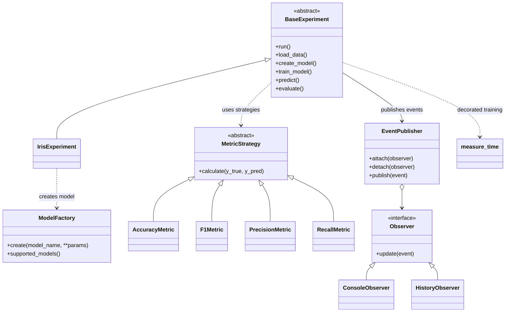

# Mini projekat 2 — Mini okvir za ML eksperimente

Mali Python okvir koji demonstrira obrasce projektovanja na Iris skupu podataka.
Implementacija koristi `scikit-learn`, a testovi `pytest`.

## 1. Šta je implementirano

| Zahtjev | Implementacija |
|---|---|
| Factory za modele | `ModelFactory` kreira Logistic Regression, Decision Tree i kNN klasifikatore |
| Strategy za metrike | `MetricStrategy` interfejs i strategije Accuracy, F1, Precision, Recall |
| Observer za praćenje treninga | `EventPublisher`, `ConsoleObserver`, `HistoryObserver` |
| Template Method | `BaseExperiment.run()` definiše standardni tok eksperimenta |
| Decorator za mjerenje vremena | `@measure_time` mjeri trajanje treniranja i objavljuje timing događaj |
| Iris demonstracija | `IrisExperiment` koristi ugrađeni Iris skup iz scikit-learn biblioteke |
| Pytest | Testovi za factory, metrike, observer i kompletan eksperiment |

## 2. Zahtjevi

- Python 3.10 ili noviji
- pip
- Visual Studio Code (preporučeno)

## 3. Pokretanje u VS Code

1. Preuzmi i raspakuj ZIP arhivu.
2. U VS Code izaberi **File → Open Folder** i otvori raspakovani folder `ml_experiment_framework`.
3. Otvori terminal u VS Code: **Terminal → New Terminal**.
4. Kreiraj virtuelno okruženje:

   **Windows (PowerShell):**
   ```powershell
   py -m venv .venv
   .venv\Scripts\Activate.ps1
   ```

   **macOS / Linux:**
   ```bash
   python3 -m venv .venv
   source .venv/bin/activate
   ```

5. Instaliraj projekat i zavisnosti:
   ```bash
   python -m pip install --upgrade pip
   pip install -e ".[dev]"
   ```
   Alternativa je `pip install -r requirements.txt`.

6. Pokreni demonstraciju:
   ```bash
   python -m ml_experiment.demo
   ```
   Ili izaberi drugi model:
   ```bash
   python -m ml_experiment.demo --model decision_tree
   python -m ml_experiment.demo --model knn
   ```

7. Pokreni testove:
   ```bash
   pytest -v
   ```
   Očekuje se da svi testovi prođu. Tačne vrijednosti metrika mogu neznatno zavisiti od verzija biblioteka.

## 4. Struktura projekta

```text
ml_experiment_framework/
├── pyproject.toml
├── requirements.txt
├── README.md
├── src/
│   └── ml_experiment/
│       ├── __init__.py
│       ├── models.py
│       ├── metrics.py
│       ├── observers.py
│       ├── decorators.py
│       ├── experiment.py
│       └── demo.py
└── tests/
    ├── test_models.py
    ├── test_metrics.py
    ├── test_observers.py
    └── test_experiment.py
```

## 5. Mermaid dijagram klasa

Dijagram prikazuje glavne klase i njihove odnose.



## 6. Objašnjenje obrazaca projektovanja

### Factory
`ModelFactory` skriva detalje kreiranja konkretnih scikit-learn modela. Ostatak programa traži model po nazivu, bez direktnog poznavanja konstruktora svake klase. Novi model se može dodati u factory.

### Strategy
Sve metrike imaju isti interfejs `calculate(y_true, y_pred)`. Funkcija `calculate_metrics` prihvata listu strategija, pa se metrike mogu dodavati ili mijenjati bez izmjene toka eksperimenta.

### Observer
`EventPublisher` šalje događaje registrovanim posmatračima. `ConsoleObserver` ispisuje događaje u terminal, dok `HistoryObserver` čuva događaje u listi. Tok eksperimenta ne mora znati šta posmatrači rade sa događajima.

### Template Method
`BaseExperiment.run()` definiše redosljed koraka: učitavanje podataka, podjela, kreiranje modela, treniranje, predikcija i evaluacija. Podklasa `IrisExperiment` implementira specifične korake, dok zajednički tok ostaje isti.

### Decorator
Dekorator `@measure_time` omotava metodu treniranja, mjeri vrijeme pomoću `perf_counter` i objavljuje događaj sa trajanjem. Ne mijenja povratnu vrijednost metode.

## 7. AI alati — dokumentovanje upotrebe

AI alat (ChatGPT) korišćen je kao pomoć pri:
- razradi strukture projekta i rasporedu modula;
- pripremi početne implementacije obrazaca projektovanja;
- pisanju README dokumentacije i Mermaid dijagrama;
- osmišljavanju pytest testova.

Konačnu odgovornost za provjeru, razumijevanje i eventualne izmjene koda ima autor projekta. Prije predaje student treba samostalno pokrenuti program i testove, pregledati implementaciju i biti spreman da objasni svaki obrazac. Ako je korišćen još neki AI alat, navesti ga ovdje i opisati konkretnu upotrebu.

## 8. Napomene za predaju

- Predaj GitHub repozitorijum i ovaj README, u skladu sa instrukcijama predmeta.
- Nemoj predavati bez pokretanja komandi za demonstraciju i testove na svom računaru.
- Ako profesor traži dokaz rada, priloži screenshot uspješnog pokretanja demo programa i `pytest -v`.
- U README dopiši svoje ime, predmet/grupu i eventualne detalje koje traži nastavnik.
